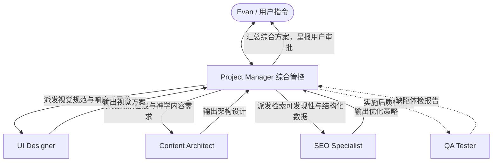

# Evan's Thinking Custom Agents 团队使用手册

欢迎来到 **Evan's Thinking** 项目定制 Agent 体系。
本目录包含面向本项目设立的 5 个专业智能体配置与协同工作流规范。

---

## 目录结构
```text
.agents/
├── AGENTS.md                  # 工作区规则总览（根目录下亦有同步版本）
├── README.md                  # 本手册
└── agents/                    # 5 位专职 Agent 角色定义
    ├── project-manager.md     # 1. Evan's Thinking Project Manager (总负责人)
    ├── ui-designer.md         # 2. UI Designer (视觉与交互设计)
    ├── content-architect.md   # 3. Content Architect (内容与神学架构)
    ├── seo-specialist.md      # 4. SEO Specialist (搜索引擎优化)
    └── qa-tester.md           # 5. QA Tester (质量与技术审计)
```

---

## 团队协同模式（Orchestration Pattern）
本团队以 **Project Manager 为核心中枢**，支持**单点专精调用**与**多 Agent 并行调度**：



---

## Antigravity 中调用方式

### 方式一：通过 Project Manager 一键统筹（推荐）
在与 Antigravity 对话时，直接向 Project Manager 发出宏观指令：
> “请 Project Manager 组织团队，对我们即将发布的《家庭事务》辅导专栏进行全面的架构规划、视觉呈现与 SEO 优化方案评估。”

Project Manager 将自动：
1. 拆解需求为视觉、内容、SEO 三个专业任务。
2. 调度 `ui-designer`、`content-architect`、`seo-specialist` 分别输出专业建议。
3. 汇总提炼为一份《执行计划提案》。
4. 呈报给您审批；获批后安排实施与 `qa-tester` 最终验收。

### 方式二：直接点名调用专业 Agent
当您有明确的单项专业需求时，可以直接点名：
- **关于视觉风格与移动端适配**：“请 @UI Designer 检查当前手机端导航抽屉的开合手感与阅读器字号设置。”
- **关于神学分类与文章关联**：“请 @Content Architect 为教会治理与重浸派神学专栏规划二级分类与内链架构。”
- **关于 Google 搜索与社交分享**：“请 @SEO Specialist 审计首页和阅读器的 Meta Title、Open Graph 标签与 sitemap.xml 配置。”
- **关于页面死链与控制台报错**：“请 @QA Tester 对整站所有页面进行一次全面的链接与移动端视口体检。”
